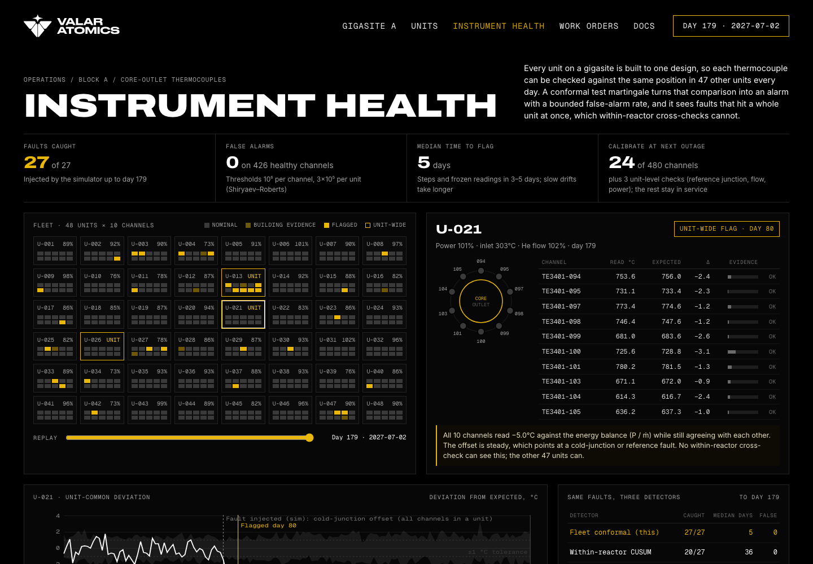

# Fleet sensor check for a Valar Atomics gigasite (concept)

**Live demo:** https://mohith26.github.io/valar-fleet-sensor-check/

An unofficial concept feature for [Valar Atomics](https://www.valaratomics.com), built by Mohith Gajjela. Not affiliated with Valar Atomics. All data is synthetic. Channel names follow the TE3401 thermocouples in Valar's public "Ward 250 By the Numbers" power-ascension plot; nothing else comes from Valar.



## What it is

Valar plans gigasites with hundreds of identical reactors (Project Beehive: 456). Every one of them carries core-outlet thermocouples that drift, step, freeze and get noisy, and calibrating thousands of channels on a fixed schedule does not scale. Nuclear online monitoring (OLM) already lets plants extend calibration intervals by watching for drift between redundant channels **inside one plant**.

A gigasite offers something a single plant does not: **47 other units built to the same design**. This demo checks each thermocouple against the same position on every other unit, every day, and turns that comparison into an alarm with a provable false-alarm bound:

- **Channel faults** (drift, step, frozen, noisy) are flagged against the fleet, not against a hand-set limit.
- **Unit-wide faults** (a cold-junction or reference offset that moves all ten channels together, or a drifting flow meter) are caught even though the unit's own channels still agree with each other, which no within-reactor cross-check can see.
- Each flag comes with a plain-language diagnosis and a calibration list for the next outage: in the demo, 24 of 480 channels plus 3 unit-level checks, instead of all 480.

## How it works (`core/olm.js`)

1. **Energy-balance model, learned at commissioning.** During the power ascension (10% to 85% in steps), each channel's outlet-minus-inlet rise is fit as `y = b_uk * P / mdot + d_uk` (the core temperature rise is proportional to power over helium flow, scaled by the local peaking at that position). The pooled slopes recover the design peaking profile to within 3%.
2. **Residuals** are split into a channel part (`r - median of the unit's channels`) and a unit-wide part (the shift that at least about 3/4 of the unit's channels share, so one or two bad channels cannot fake a unit fault). Daily means are used, with a ±1 °C dead band (inside calibration tolerance carries no evidence), and days below 30% power are skipped.
3. **Conformal p-values across the fleet.** Each day, a channel's |residual| is ranked among all other channels in the fleet that day (standardized per position); a unit's shift is ranked among the other units. Identical units are each other's reference, so no noise model is assumed.
4. **Shiryaev–Roberts conformal martingale** per stream: `R_d = (R_{d-1} + 1) * g(p_d)` with the mixture betting function `g(p) = ∫ ε p^(ε-1) dε`. Under no fault the p-values are uniform, `R_n - n` is a martingale, and the mean time to a false alarm is at least the threshold A in days: A = 10^6 per channel and 3×10^5 per unit.
5. **Quarantine:** flagged channels and units leave the reference pool.

Baselines, given the same residuals: a **fixed ±10 °C cross-check** against the unit's other channels (status-quo style), and a **within-reactor two-sided CUSUM** on the same daily residuals with threshold h = 40, tuned to near-zero false alarms.

Everything on the page is computed in the browser from the seeded simulator (`core/fleet.js`) on load.

## The synthetic gigasite block

`simulate(20270104)`: 48 identical HTGR units, 10 core-outlet thermocouples each, sampled every 4 hours for 180 days. 300 °C inlet, about 400 °C rise at full power, partial flow control (`mdot = 0.35 + 0.65 P`), weekly and daily load following, 1-2 planned outages per unit, a static neutron-power calibration error per unit, per-channel installation offsets (σ 3.5 °C) and local peaking variation (2%), shared unit process noise and AR(1) channel noise. 27 faults start after commissioning: 10 calibration drifts (0.6-3 °C/month), 6 steps (3-10 °C), 4 frozen readings, 4 intermittent-noise channels, 2 unit-wide cold-junction offsets (3-6 °C) and 1 flow-meter drift (1-2.5%/month).

## Results (seed 20270104, `node scripts/report.mjs`)

| Detector | Caught | Median days to flag | False alarms |
|---|---|---|---|
| **Fleet conformal (this)** | **27/27** | **5** | **0** |
| Within-reactor CUSUM (h = 40) | 20/27 | 36 | 0 |
| Fixed ±10 °C cross-check | 13/27 | 0 | 0 |

By type (fleet / CUSUM / fixed): drift 10/9/2, step 6/6/3, frozen 4/4/4, noisy 4/0/4, cold junction 2/0/0, flow meter 1/1/0. Steps and frozen readings are flagged in about 4 days, drifts in a median 27 days; the fixed limit only catches the two fastest drifts, after about 90 days.

## Does it hold up? (`node scripts/validate.mjs 20`)

Thresholds were chosen on seeds 11-18; these are 20 fresh blocks (seeds 1000-1019), 540 faults, 8,520 healthy channel-runs:

| Detector | Caught | Median days | False channel alarms | False unit alarms |
|---|---|---|---|---|
| **Fleet conformal** | **534/540 (98.9%)** | 11 | 5 | 3 |
| Within-reactor CUSUM | 367/540 (68.0%) | 14 | 0 | 0 |
| Fixed ±10 °C | 251/540 (46.5%) | 1 | 0 | 0 |

Fleet misses are 6 slow drifts that started late in the run. Cold-junction faults: 40/40 vs 0/40 for both within-reactor methods. The CUSUM's zero false alarms come from a high threshold, which is also why it misses most noisy channels and slow drifts.

## Tests

```
node --test test/olm.test.mjs
```

9 tests: simulator determinism and fault schedule; the betting function integrates to 1 under uniform p (so the martingale property holds); commissioning fit recovers the design profile; healthy-channel p-values pass a chi-square uniformity test; demo seed catches every fault with no false alarms and beats both baselines, including unit-wide faults the baselines cannot see; held-out seeds catch at least 95% with at most 1 channel and 2 unit false alarms; no alarm fires before its fault; the plain-language diagnosis matches the injected fault type for at least 75% of channel faults; and the scorer counts early alarms as false.

## Honest limitations

- **Synthetic data, and no public in-app screenshots exist** of Valar's operations software; the UI follows Valar's public web design system (black canvas, mono uppercase labels, gold #e9b709 from their CSS). Saans, Saans Mono and Druk are commercial fonts, so Inter, Geist Mono and Archivo Expanded stand in.
- The model is a linear energy balance. Real outlet thermocouples see bypass flow, thermal lag in transients and nonlinear behaviour at low flow; transient days are skipped here rather than modeled.
- The false-alarm guarantee assumes day-to-day exchangeability. Residuals are mildly autocorrelated (lag-1 about 0.2), and the held-out runs show 5 channel and 3 unit false alarms across 20 half-year blocks, so the bound is not exact in practice.
- It needs a fleet. With a handful of units the p-values are coarse (1/(n+1)) and detection slows; Ward 250 alone could only use its own channels.
- A flow-meter or power-channel fault also produces small channel-specific residuals, so a few channels in that unit get flagged too; the unit-wide diagnosis takes precedence in the UI and calibration list.
- Detection of slow drifts (under about 1 °C/month) takes weeks; that is the price of near-zero false alarms.

## Novelty note

Checked Valar's site, docs library (Series B, Project NOVA, Ward 250 By the Numbers, QAPD, roadmap), job posts (I&C, automation and controls) and news through Nov 2026: no announced online monitoring, sensor validation or fleet-level instrument software. In the industry, OLM (EPRI/AMS, MSET-SPRT) compares redundant channels within one plant and needs tuned noise models; I found no fleet-referenced conformal approach for identical reactor units.
